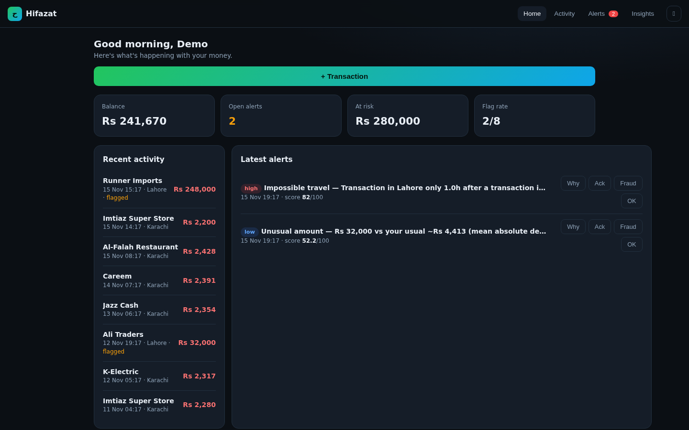
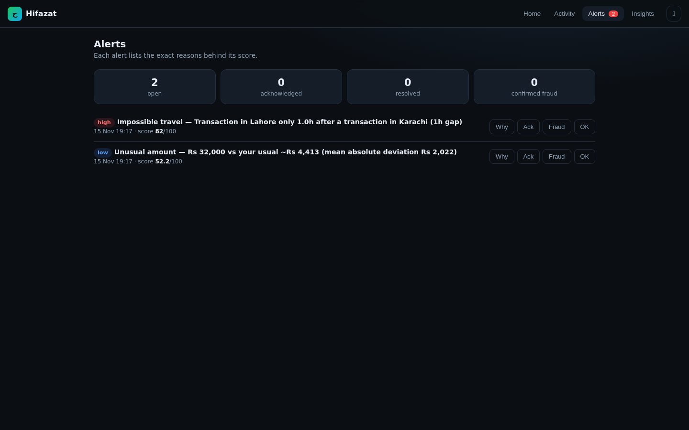
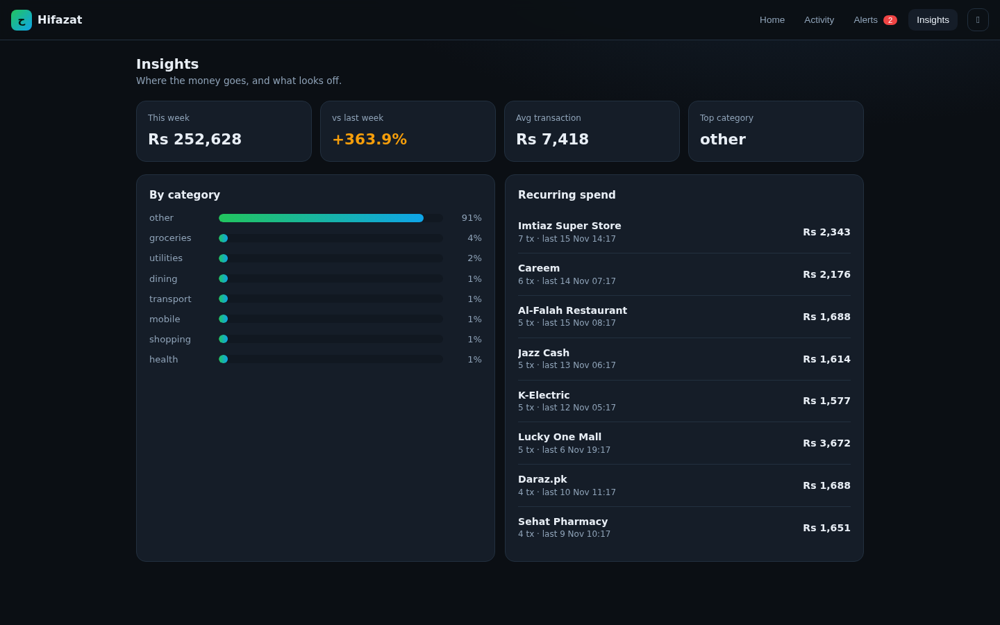
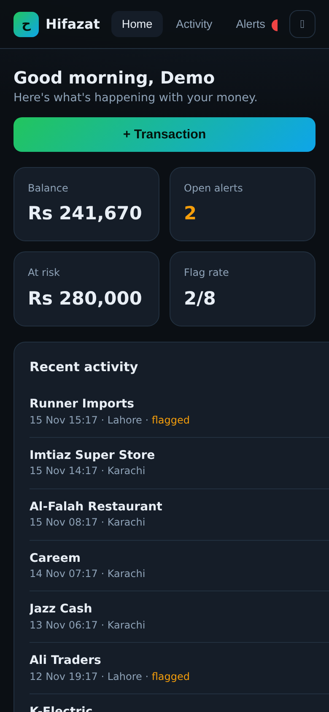

# Hifazat (حفاظت)

Personal finance tracking with a fraud detection engine that shows its work.

Hifazat watches your transactions through seven explainable anomaly rules —
amount spikes, impossible travel, spending velocity, midnight bursts and more —
and raises realtime, resovable alerts. No black box: every alert is a weighted
sum of named, human-readable reasons, so "why" is always one glance away.

## Why it exists

Most personal finance tools will happily show you a neat chart of the month you
got emptied by a compromised card. Hifazat is different — it learns your normal
spending pattern per account (amount, cadence, cities, merchants) with an
online, exponentially-weighted profile, and flags the transaction that does not
fit *while it is still fresh*: an over-limit midnight purchase, a card used in
Karachi at 2 am that was in Lahore at 6 pm, a spending burst a stranger would
never match.

It deliberately uses **no trained model**. The rules are deterministic, the
scores are decomposable, and the explanation is printed on the alert.

## Features

- **7-rule anomaly engine** — amount spikes, rapid geo change (with a hard
  floor: impossible travel never scores below 82), geo travel, velocity,
  high-frequency bursts, new payees, off-hours spend. Weights in one table.
- **Online per-account profiles** — EMA of amount, EMA of mean absolute
  deviation (robust scale), EMA of time-gaps, seen cities/merchants, all
  updated transactionally with each transaction.
- **Realtime alerts** — WebSocket push to your dashboard the moment a
  transaction flags; full alert lifecycle (open → acknowledged →
  resolved false_positive / confirmed_fraud).
- **Insights** — spending by category, week-over-week change, expense ratio,
  recurring merchant detection, sum of at-risk amount.
- **JWT + bcrypt auth**, per-account ownership (foreign resources return 404),
  rate limits, security headers, secrets only in env.
- **Mobile-first dark dashboard** — no build step, vanilla JS, works from a
  phone.

## Screenshots

**Dashboard** — balance, open alerts, at-risk amount, and the latest alerts.



**Alerts** — every alert carries the exact reasons behind its score.



**Insights** — where the money goes, and what looks off.



**Mobile** — the whole dashboard works from a phone.



Also in `screenshots/`: `01-login.png`, `03-transactions.png`.

## Tech stack

FastAPI · SQLAlchemy 2.0 · Pydantic v2 · JWT + bcrypt · slowapi · WebSockets ·
vanilla-JS SPA · SQLite (dev) / PostgreSQL 16 (Docker) · pytest · ruff

## Quickstart (local)

```bash
git clone https://github.com/mohdabrarbaloch-arch/day-23-hifazat.git
cd day-23-hifazat
python -m venv .venv && source .venv/bin/activate
pip install -e ".[dev]"
cp .env.example .env
python -c "import secrets; print('JWT_SECRET=' + secrets.token_urlsafe(48))" >> .env
python -m app.seed
uvicorn app.main:app --reload
```

Open http://127.0.0.1:8000 and sign in with the demo account
(`demo@hifazat.pk` / `demo12345`). The seed creates 45 days of realistic
transactions including a live fraud story.

## Docker (production-like, with PostgreSQL)

```bash
docker compose up --build
```

App on http://localhost:8000, PostgreSQL 16 on :5432. Full docs:
[docs/setup.md](docs/setup.md) · [docs/usage.md](docs/usage.md) ·
[docs/api.md](docs/api.md) · [ARCHITECTURE.md](ARCHITECTURE.md)

## Demo data behaviour

The seed loads 45 days of history and replays it through the engine, so the
demo account arrives with a warm profile and a handful of real alerts —
including one "impossible travel" situation (Lahore → Karachi) that scores in
the 90s. Registering a fresh account starts with a cold profile: the engine
quietly learns for the first several transactions before scores mean anything.

## Tests & lint

```bash
pytest -q        # engine + API + websocket suites
ruff check .     # lint
ruff format --check .   # formatting
```

## Deployment

The repo ships a `Dockerfile`, `docker-compose.yml`, and a Vercel serverless
entry (`api/index.py` + `vercel.json`). Production needs `DATABASE_URL` to a
real PostgreSQL (Neon/Supabase) and a strong `JWT_SECRET`. See
[docs/setup.md](docs/setup.md) for the exact steps.

## License

MIT — see [LICENSE](LICENSE). Built by ABraz Baloch as part of the
Autonomous AI Software Engineer 30-day challenge (Day 23).
